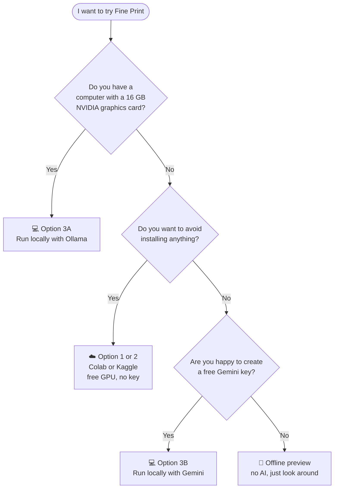

<div align="center">

# 📑 Fine Print

### AI-powered M&A agreement review and deal simulation

*Upload a merger agreement. Get the risky clauses, the deal economics, a stress-tested cash-flow forecast, a score out of 100 and advice on what to renegotiate.*


[Colab](#-option-1-google-colab-easiest-no-install) ·
[Kaggle](#-option-2-kaggle) ·
[Run on your computer](#-option-3-run-on-your-own-computer) ·
[Hardware](#-hardware-requirements) ·
[Troubleshooting](#-troubleshooting)

</div>

---

## ✨ What is this?

Fine Print reads M&A agreements (merger agreements, letters of intent, SEC filings saved as `.txt`) and, in a web app that opens in your browser, it:

| | What you get |
|---|---|
| 🔍 **Flags risky fine print** | 25 rule-based clause checks plus an AI review across 10 risk categories |
| 📄 **Summarises the deal** | A plain-English executive summary of the agreement |
| 💰 **Extracts the numbers** | Price, debt, fees, escrow and other deal terms, each with a quote from the text |
| 📈 **Simulates cash flow** | 36 months, 5 stress scenarios and a 2,000-run Monte Carlo |
| 🎯 **Scores the deal** | A transparent 100-point scorecard (A to D) that shows the reason for every deduction |
| 🛡️ **Suggests countermeasures** | Renegotiation points, escrow sizing, price headroom, walk-away triggers |
| 💬 **Answers questions** | "Ask the agreement" replies only from the text, with citations |

> **The AI reads and judges. Plain Python does the money.** Every number in the simulation and the scorecard comes from a formula, not from an AI guess.

> [!WARNING]
> Fine Print is decision support, **not legal or investment advice**. Always check each flag against the original clause.

---

## 🔑 Important: no API key is included

> [!IMPORTANT]
> **This project does not come with an API key, and you do not need one to use it.** You choose how the AI runs:
>
> | Choice | Needs an API key? | Needs a strong GPU? | Your documents |
> |---|:---:|:---:|---|
> | 🦙 **Ollama** (local, open models) | **No** | **Yes** (16 GB GPU recommended) | Stay on the machine running Ollama |
> | ✨ **Google Gemini** (cloud) | **Yes, your own** (free to create) | No | Sent to Google's API |
>
> If you pick Gemini, you create **your own** key (instructions in [Getting a Gemini API key](#-getting-a-gemini-api-key-only-if-you-choose-gemini)). Never paste your key into a public place, and never upload it to GitHub.

---

## 🧭 Which option is right for me?



| | Option | AI | Setup time | Best for |
|---|---|---|---|---|
| ☁️ | [**1. Google Colab**](#-option-1-google-colab-easiest-no-install) | Ollama on a free T4 GPU | ~10 min | **Beginners.** Nothing to install |
| 🏆 | [**2. Kaggle**](#-option-2-kaggle) | Ollama on a free T4 GPU | ~10 min | Same, with a weekly GPU quota |
| 💻 | [**3A. Your computer + Ollama**](#3a-local-ai-with-ollama-no-key-needs-a-good-gpu) | Local open models | ~20 min | Privacy, working offline |
| 💻 | [**3B. Your computer + Gemini**](#3b-cloud-ai-with-gemini-any-laptop-needs-your-own-key) | Google Gemini | ~10 min | Ordinary laptops with no GPU |
| 👀 | [**Offline preview**](#-offline-preview-no-ai-at-all) | None | ~10 min | A look at the app, nothing more |

---

## 🧰 Before you start: a few basics

<details>
<summary><b>What is a "terminal" and where do I find it?</b></summary>

A terminal is a window where you type commands. Commands in this guide are shown in grey boxes. Copy one, paste it into the terminal and press **Enter**.

- **Windows:** press the Start button, type `PowerShell`, press Enter.
- **macOS:** press `⌘ + Space`, type `Terminal`, press Enter.
- **Linux:** press `Ctrl + Alt + T`.

</details>

<details>
<summary><b>What is a "notebook cell" (Colab and Kaggle)?</b></summary>

Colab and Kaggle show a page made of boxes called **cells**. Paste the code into a cell and run it with the ▶ button on its left (or `Shift + Enter`). Wait for it to finish, then move on to the next cell. Lines that start with `!` or `%` are notebook commands, so paste them into a cell, not into a terminal.

</details>

<details>
<summary><b>How do I get the project onto my computer?</b></summary>

**Easiest, no extra software:** on this GitHub page click the green **Code** button, choose **Download ZIP**, then unzip it (right-click, *Extract All*). Open a terminal in the unzipped folder: type `cd ` (with a space), drag the folder into the terminal window and press Enter.

**With Git** (if you have it installed):

```bash
git clone https://github.com/YOUR_USERNAME/YOUR_REPO.git
cd YOUR_REPO
```

</details>

> [!NOTE]
> **For the repo owner:** replace `YOUR_USERNAME/YOUR_REPO` everywhere with this repository's path. The commands assume `app.py`, `utils.py` and `scripts/` sit at the top level of the repo. If they live in a sub-folder (for example `ma_fineprint_engine/`), add `cd ma_fineprint_engine` after cloning.

---

## ☁️ Option 1: Google Colab (easiest, no install)

Colab is a free Google service that runs code on a Google computer, including a free **NVIDIA T4 GPU**, which is the exact graphics card this project is tuned for. You need a Google account. Nothing is installed on your own computer.

### Step by step

1. Go to **[colab.research.google.com](https://colab.research.google.com)** and sign in. Click **New notebook**.
2. Turn on the GPU: menu **Runtime → Change runtime type → T4 GPU → Save**.
3. Click **+ Code** to add a cell, paste the block below, and run it. Repeat for each block.

**Cell 1: check that you have the GPU.** It should print `Tesla T4`.

```python
!nvidia-smi --query-gpu=name,memory.total --format=csv
```

**Cell 2: download the project.**

```python
!git clone https://github.com/YOUR_USERNAME/YOUR_REPO.git
%cd YOUR_REPO
```

**Cell 3: install everything.** This installs Ollama, downloads the AI models (about 10 GB) and installs the Python packages. It takes around 5 minutes and prints a lot of text. That is normal.

```python
!bash scripts/setup_t4.sh
```

**Cell 4: speed check.** Both models should say **`100% on GPU`**.

```python
!python3 scripts/benchmark_ollama.py
```

**Cell 5: start the app and get a link.**

```python
import subprocess, re, time, pathlib

subprocess.Popen(["bash", "scripts/start_app.sh", "--public"],
                 stdout=open("start.log", "w"), stderr=subprocess.STDOUT,
                 start_new_session=True)

for _ in range(90):
    log = pathlib.Path("tunnel.log").read_text() if pathlib.Path("tunnel.log").exists() else ""
    m = re.search(r"https://[a-z0-9-]+\.trycloudflare\.com", log)
    if m:
        print("Open the app:", m.group(0)); break
    time.sleep(2)
else:
    print("No link yet. See start.log and tunnel.log")
```

4. Click the `https://….trycloudflare.com` link that appears. 🎉 That is the app.

> [!TIP]
> Keep the Colab tab open while you use the app. When you close it or the session times out, the app and everything downloaded are deleted, and you start again from Cell 1 next time.

<details>
<summary><b>Prefer Gemini on Colab (no GPU needed)?</b></summary>

1. Create your own key: see [Getting a Gemini API key](#-getting-a-gemini-api-key-only-if-you-choose-gemini).
2. In Colab click the 🔑 **Secrets** icon in the left bar → **Add new secret** → name it `GEMINI_API_KEY`, paste your key as the value, and switch on **Notebook access**.
3. Run this instead of Cells 3 and 4 (Cells 1 and 2 first):

```python
!pip install -q -r requirements.txt

import os
from google.colab import userdata
os.environ["GEMINI_API_KEY"] = userdata.get("GEMINI_API_KEY")
!sed -i 's/^LLM_PROVIDER = .*/LLM_PROVIDER = "gemini"/' utils.py
```

4. Run Cell 5 to start the app. A note saying "Ollama is not running" is harmless when you use Gemini.

</details>

<details>
<summary><b>Already have the project as a .zip? Use the included notebook</b></summary>

The repo ships `notebooks/run_on_colab_t4.ipynb`, which does the same steps but asks you to upload the project as a zip file. In Colab choose **File → Upload notebook** and run the cells in order.

</details>

---

## 🏆 Option 2: Kaggle

Kaggle also offers free GPUs (two T4s, with a weekly quota). The app uses one of them. The steps are the same as Colab, with a few Kaggle settings first.

### Step by step

1. Sign in at **[kaggle.com](https://www.kaggle.com)**. Verify your phone number (*Settings → Phone verification*), because Kaggle requires this for GPU and internet access.
2. Click **Create → New Notebook**.
3. Open the notebook's **Session options** panel (right-hand side) and set:
   - **Accelerator** → **GPU T4 ×2** (one T4 is fine too). Avoid P100: it is an older GPU and not what this project is tuned for.
   - **Internet** → **On**. Without internet, the model download and the public link will fail.

   *(Kaggle's menus change from time to time. Look for the words "Accelerator" and "Internet".)*
4. Add a cell for each block below and run them in order.

**Cell 1: use one GPU, then check it.** This must run first.

```python
import os
os.environ["CUDA_VISIBLE_DEVICES"] = "0"
!nvidia-smi --query-gpu=name,memory.total --format=csv
```

**Cell 2: download the project.**

```python
!git clone https://github.com/YOUR_USERNAME/YOUR_REPO.git
%cd YOUR_REPO
```

**Cell 3: install Ollama, the models and the packages** (about 5 minutes).

```python
!bash scripts/setup_t4.sh
```

**Cell 4: speed check.** Look for `100% on GPU`.

```python
!python3 scripts/benchmark_ollama.py
```

**Cell 5: start the app and get a link.**

```python
import subprocess, re, time, pathlib

subprocess.Popen(["bash", "scripts/start_app.sh", "--public"],
                 stdout=open("start.log", "w"), stderr=subprocess.STDOUT,
                 start_new_session=True)

for _ in range(90):
    log = pathlib.Path("tunnel.log").read_text() if pathlib.Path("tunnel.log").exists() else ""
    m = re.search(r"https://[a-z0-9-]+\.trycloudflare\.com", log)
    if m:
        print("Open the app:", m.group(0)); break
    time.sleep(2)
else:
    print("No link yet. See start.log and tunnel.log")
```

5. Click the link that appears.

> [!TIP]
> Use the normal interactive notebook. If you press **Save & Run All** (a batch run), the app stops as soon as the cells finish. When you are done, stop the session so you don't waste your weekly GPU hours.

<details>
<summary><b>Prefer Gemini on Kaggle (no GPU needed)?</b></summary>

1. Create your own key: see [Getting a Gemini API key](#-getting-a-gemini-api-key-only-if-you-choose-gemini).
2. In the notebook menu choose **Add-ons → Secrets → Add Secret**, name it `GEMINI_API_KEY`, paste the key and attach it to the notebook.
3. Run Cells 1 and 2, skip Cells 3 and 4, and run this instead:

```python
from kaggle_secrets import UserSecretsClient
import os
os.environ["GEMINI_API_KEY"] = UserSecretsClient().get_secret("GEMINI_API_KEY")
!pip install -q -r requirements.txt
!sed -i 's/^LLM_PROVIDER = .*/LLM_PROVIDER = "gemini"/' utils.py
```

4. Run Cell 5.

</details>

---

## 💻 Option 3: Run on your own computer

### 🧱 Hardware requirements

Pick your row. The AI model is what needs the hardware, so the table depends on which AI you choose.

| Setup | GPU (graphics card) | RAM | Free disk | Model used | Experience |
|---|---|---|---|---|---|
| 🏆 **Recommended** (local, Ollama) | **NVIDIA with 16 GB of video memory**, e.g. Tesla T4, RTX 4060 Ti 16 GB, RTX 4080, RTX 3090/4090 (24 GB) | 16 GB | **~15 GB** | `qwen3:14b` | Best quality. A long agreement reviews in about 8–15 min on a T4 |
| ⚡ **Lighter** (local, Ollama) | NVIDIA with 8–12 GB of video memory (e.g. RTX 3060, 4070) | 16 GB | **~10 GB** | `qwen3:8b` | About twice as fast, slightly weaker on long clauses |
| 🍎 **Apple Silicon Mac** (local, Ollama) | Built in (M1, M2, M3, M4) | 16 GB for `qwen3:8b`; 32 GB or more for `qwen3:14b` | **~10–15 GB** | `qwen3:8b` or `qwen3:14b` | Uses shared "unified" memory |
| 🪶 **Any laptop** (cloud, Gemini) | None needed | 8 GB | **~3 GB** (Python packages only) | Gemini | Fast. Needs internet and your own key |
| 🐌 **No GPU, local AI** | None | 16 GB or more | ~10 GB | `qwen3:8b` | **Not recommended.** It runs on the CPU and is extremely slow. Use Gemini, Colab or Kaggle instead |

Also needed on every setup:

- **Operating system:** Windows 10/11, macOS or Linux (64-bit).
- **Python 3.10 or newer** (3.11 or 3.12 is a safe choice).
- **Internet** for the one-time install and model download (about 10 GB for the recommended setup).
- A modern web browser.

> [!NOTE]
> The project is tuned and benchmarked on a **16 GB NVIDIA T4**. The other rows are estimates based on the model sizes (`qwen3:14b` ≈ 9.3 GB, `qwen3:8b` ≈ 5.2 GB, embedding model ≈ 0.3 GB, plus working memory). If a model doesn't fit in your GPU's memory, Ollama pushes part of it to the CPU and everything slows down. The [speed check](#step-3a5-check-the-speed-optional-but-useful) shows whether that happened. AMD GPUs may work through Ollama too, but they haven't been tested with this project.

<details>
<summary><b>How do I check my GPU and memory?</b></summary>

- **NVIDIA (Windows or Linux):** open a terminal and run `nvidia-smi`. The table shows your card's name and its total memory (for example `16384MiB` is 16 GB).
- **Windows, any GPU:** Task Manager (`Ctrl + Shift + Esc`) → **Performance** → **GPU** → *Dedicated GPU memory*.
- **Mac:** Apple menu → **About This Mac** shows the chip and memory.

</details>

---

### Step 1: Install Python

Check whether you already have it:

```bash
python3 --version
```

On Windows, if that fails, try `python --version` or `py --version`. You need **3.10 or newer**.

If you need to install it:

- **Windows:** download it from [python.org/downloads](https://www.python.org/downloads/). In the installer, **tick "Add python.exe to PATH"** before you click *Install Now*.
- **macOS:** download it from [python.org/downloads](https://www.python.org/downloads/) or run `brew install python` if you use Homebrew.
- **Linux (Ubuntu/Debian):** `sudo apt update && sudo apt install -y python3 python3-venv python3-pip`

### Step 2: Get the project and install its packages

Download the project (see [How do I get the project onto my computer?](#-before-you-start-a-few-basics)) and open a terminal inside the project folder. Then:

```bash
python3 -m venv .venv
```

*(On Windows use `python -m venv .venv` or `py -m venv .venv`.)* This creates a private space for the project's packages. Now switch it on:

| System | Command |
|---|---|
| macOS / Linux | `source .venv/bin/activate` |
| Windows PowerShell | `.venv\Scripts\Activate.ps1` |
| Windows Command Prompt | `.venv\Scripts\activate.bat` |

You should now see `(.venv)` at the start of your terminal line. Install the packages:

```bash
pip install -r requirements.txt
```

> [!TIP]
> **Windows says "running scripts is disabled"?** Run `Set-ExecutionPolicy -Scope CurrentUser RemoteSigned`, answer `Y`, then try the activate command again.

Now choose how the AI will run: **3A (Ollama, no key)** or **3B (Gemini, your own key)**.

---

### 3A. Local AI with Ollama (no key, needs a good GPU)

**Ollama** is a free program that runs open AI models on your own computer. It keeps everything on your machine and needs no account and no API key.

#### Step 3A.1: Install Ollama

<table>
<tr>
<td><b>🪟 Windows</b></td>
<td>

1. Go to **[ollama.com/download](https://ollama.com/download)** and click **Download for Windows**.
2. Run `OllamaSetup.exe` and click through the installer.
3. When it finishes, Ollama runs quietly in the background. You'll see its llama icon in the system tray (bottom-right, you may need to click the `^`).

</td>
</tr>
<tr>
<td><b>🍎 macOS</b></td>
<td>

1. Go to **[ollama.com/download](https://ollama.com/download)** and click **Download for macOS**.
2. Open the downloaded file and drag **Ollama** into **Applications**.
3. Open Ollama from Applications and approve any prompts. A llama icon appears in the menu bar.

</td>
</tr>
<tr>
<td><b>🐧 Linux</b></td>
<td>

Run this in a terminal (it also sets Ollama up as a background service):

```bash
curl -fsSL https://ollama.com/install.sh | sh
```

**Shortcut:** on Linux you can skip steps 3A.1 to 3A.4 entirely. The project's script installs Ollama, tunes it for a 16 GB GPU, downloads the models and installs the packages in one go:

```bash
bash scripts/setup_t4.sh
```

</td>
</tr>
</table>

Check that it installed. Open a **new** terminal and run:

```bash
ollama --version
```

If you see a version number, it works. If you get "command not found", close and reopen the terminal (Windows may need a sign-out and back in), or reinstall.

#### Step 3A.2: Download the AI models

This is a one-time download of about 10 GB, so use a good connection and give it a few minutes.

```bash
ollama pull qwen3:14b
ollama pull nomic-embed-text
```

- `qwen3:14b` is the **chat model** that reads and reasons about the agreement (~9.3 GB).
- `nomic-embed-text` is the small **search model** that finds the relevant passages (~0.3 GB).

> [!TIP]
> **Less than 16 GB of video memory?** Download the lighter model instead: `ollama pull qwen3:8b` (~5.2 GB), and set `OLLAMA_MODEL = "qwen3:8b"` in the next step.

Confirm both are there:

```bash
ollama list
```

#### Step 3A.3: Check the settings file

Open **`utils.py`** in any text editor (Notepad, TextEdit, VS Code…). It already comes set for Ollama, so for the recommended setup you change **nothing**. The lines that matter:

```python
LLM_PROVIDER = "ollama"          # "ollama" = local AI, "gemini" = cloud AI
OLLAMA_MODEL = "qwen3:14b"       # use "qwen3:8b" if you have less video memory
OLLAMA_CONTEXT = 16384           # lower to 12288 if you run out of memory
```

If you did change something, save the file.

#### Step 3A.4: Start the app

Make sure Ollama is running (llama icon in your tray or menu bar), your `(.venv)` is active, and you are in the project folder, then:

```bash
streamlit run app.py
```

Your browser opens at **<http://localhost:8501>**. If it doesn't, open that address yourself.

On a Linux server or cloud VM you can also use `bash scripts/start_app.sh` (add `--public` for a temporary shareable link).

#### Step 3A.5: Check the speed (optional but useful)

In a second terminal (project folder, `.venv` active):

```bash
python3 scripts/benchmark_ollama.py
```

Both models should show **`100% on GPU`**. Anything lower means part of the model has spilled onto the CPU, which is much slower. Fix it with the lighter model (`qwen3:8b`) or a smaller `OLLAMA_CONTEXT`.

<details>
<summary><b>Optional: speed-up settings for Ollama (advanced)</b></summary>

`scripts/setup_t4.sh` applies these automatically on Linux. On Windows and macOS you can ignore them for a first run, and add them later if you want extra speed:

| Setting | Value | Effect |
|---|---|---|
| `OLLAMA_FLASH_ATTENTION` | `1` | Faster, lower memory use |
| `OLLAMA_KV_CACHE_TYPE` | `q8_0` | Halves memory used by long context |
| `OLLAMA_NUM_PARALLEL` | `2` | Handles two requests at once |
| `OLLAMA_MAX_LOADED_MODELS` | `2` | Keeps chat and search models loaded |
| `OLLAMA_KEEP_ALIVE` | `30m` | Avoids reloading between steps |

**Windows:** Start → type *"environment variables"* → *Edit environment variables for your account* → **New…** for each one, then quit Ollama from the tray and start it again.
**macOS:** `launchctl setenv OLLAMA_FLASH_ATTENTION 1` (and so on), then restart Ollama.

</details>

---

### 3B. Cloud AI with Gemini (any laptop, needs your own key)

You don't need a GPU or Ollama for this route. Instead you need an internet connection and an API key that **you** create.

> [!IMPORTANT]
> **No API key is provided with this project.** Create your own, free, in a couple of minutes. Without a key, Gemini mode shows the [offline preview](#-offline-preview-no-ai-at-all) with placeholder AI text.

#### 🔐 Getting a Gemini API key (only if you choose Gemini)

1. Go to **[aistudio.google.com/apikey](https://aistudio.google.com/apikey)** and sign in with a Google account.
2. Click **Create API key** and copy it. It starts with `AIza`.
3. Treat it like a password. Don't share it, post it, or commit it to GitHub.

The free tier has usage limits. If you see rate-limit errors, see [Troubleshooting](#-troubleshooting).

> [!NOTE]
> With Gemini, the text of the agreements you analyse is sent to Google's API. If your documents are confidential, prefer Ollama (Option 3A), which keeps everything on your machine.

#### Step 3B.1: Tell the app to use Gemini and give it your key

Open **`utils.py`** in a text editor and change these two lines. Keep the quotation marks.

```python
LLM_PROVIDER = "gemini"
GEMINI_API_KEY = "AIzaPASTE-YOUR-OWN-KEY-HERE"
```

Save the file.

<details>
<summary><b>Safer: keep the key out of the code file</b></summary>

Leave `GEMINI_API_KEY = ""` in `utils.py` and put the key in a file called `.env` instead (this repo's `.gitignore` already keeps `.env` out of Git):

1. Copy `.env.example` to a new file named `.env`.
2. Add a line: `GEMINI_API_KEY=AIzaPASTE-YOUR-OWN-KEY-HERE`
3. Keep `LLM_PROVIDER = "gemini"` in `utils.py`.

</details>

#### Step 3B.2: Start the app

```bash
streamlit run app.py
```

Your browser opens at **<http://localhost:8501>**.

---

### 👀 Offline preview (no AI at all)

Just want to look around? This runs the app with a stand-in for the AI. Chunking, search, rule checks, the cash-flow simulation, the scorecard and the charts are all real. The summary, the AI risk review and the recommendations show placeholder text.

| System | Command |
|---|---|
| macOS / Linux | `MA_DEMO=1 streamlit run app.py` |
| Windows PowerShell | `$env:MA_DEMO="1"; streamlit run app.py` |

---

## ✅ How do I know it's working?

Open <http://localhost:8501> (or your Colab/Kaggle link). In the **top-right corner** you should see one of:

- 🟢 **Running locally on Ollama (qwen3:14b)**
- 🟢 **Connected to Gemini (model name)**

If something is wrong (Ollama isn't running, a model is missing, the key is rejected or has missing quotes), the start screen says exactly what, and you can fix it and reload the page.

## 🚀 Using the app

1. **Pick an agreement** on the start screen:
   - 📚 **Bundled samples:** a real Cisco/Acacia agreement, and a fictional one with deliberately planted risky clauses. Start here.
   - 🗂️ **Library:** drop `.txt` files into the `data/raw/` folder and they appear automatically.
   - ⬆️ **Upload:** one or many `.txt` files, a `.zip` of them, or a whole folder.
2. **Wait for the review.** It makes about 13 AI calls. With `qwen3:14b` on a T4, a long agreement takes about 8–15 minutes (about half that with `qwen3:8b`). Gemini is usually faster.
3. **Explore the tabs:** Document & RAG · Summary · Cash flow · Score · Growth · Risks · Mitigation · Ask.
4. **Change the assumptions.** The agreement rarely contains the buyer's own financials, so some inputs start as illustrative estimates, marked with `*`. Enter real figures on the **Cash flow** tab and press **Update simulation**. This re-runs the simulation and scorecard without calling the AI again.
5. **Download** the report as a Markdown memo.

> [!NOTE]
> Input must be **plain text (`.txt`)**. Convert PDFs and Word files to text first. Agreements split into numbered, overlapping pieces (`contract_0.txt_1.txt`, `contract_0.txt_2.txt`, …) are stitched back together automatically.

## 🔄 Stopping and starting again

- **Stop the app:** click the terminal it's running in and press `Ctrl + C`.
- **Start it again later:** open a terminal in the project folder, switch the environment on (`source .venv/bin/activate` or `.venv\Scripts\Activate.ps1`), make sure Ollama is running (if you use it), then `streamlit run app.py`. You don't need to install anything again.
- **Update to the newest version:** `git pull` (or download the ZIP again), then `pip install -r requirements.txt`.

---

## 🛠️ Configuration cheat sheet

Everything you normally change is in **`utils.py`**:

| Setting | Default | What it does |
|---|---|---|
| `LLM_PROVIDER` | `"ollama"` | `"ollama"` = local AI, `"gemini"` = Google's cloud AI |
| `OLLAMA_MODEL` | `"qwen3:14b"` | Local chat model. `"qwen3:8b"` is about twice as fast |
| `OLLAMA_EMBED_MODEL` | `"nomic-embed-text"` | Local search model |
| `OLLAMA_CONTEXT` | `16384` | How much text the AI reads at once. Use `12288` if memory runs out |
| `OLLAMA_PARALLEL` | `2` | Requests handled at once (matches the Ollama server setting) |
| `GEMINI_API_KEY` | `""` | **Your own** Gemini key (none is provided) |
| `GEMINI_MODEL` | `"gemini-3.8-flash"` | Which Gemini model to use |
| `GEMINI_THINKING_LEVEL` | `""` | `""`, `low`, `medium` or `high` |

Advanced options (chunk size, parallel calls, caching…) live in an optional `.env` file. See `.env.example`. After changing an Ollama setting on Colab, Kaggle or Linux, re-run `scripts/setup_t4.sh` so the server picks it up.

---

## 🩺 Troubleshooting

| Problem | What to do |
|---|---|
| **"ollama: command not found"** | Close and reopen the terminal. If it persists, reinstall Ollama from [ollama.com/download](https://ollama.com/download) |
| **Start screen says Ollama can't be reached** | Make sure Ollama is running: open the Ollama app, or run `ollama serve` in a separate terminal. On Colab/Kaggle re-run the setup cell and check `ollama.log` |
| **"Model not installed"** | `ollama pull qwen3:14b` and `ollama pull nomic-embed-text` (or whichever names are in `utils.py`) |
| **Out-of-memory errors, or the benchmark shows less than 100% on GPU** | Set `OLLAMA_MODEL = "qwen3:8b"` (and pull it) or `OLLAMA_CONTEXT = 12288` in `utils.py`, then restart the app. On Kaggle, make sure Cell 1 (`CUDA_VISIBLE_DEVICES`) ran first |
| **Everything is incredibly slow** | There's no GPU in use. On Colab or Kaggle make sure a T4 is selected. On your own machine use Gemini, or a smaller model |
| **`nvidia-smi: command not found`** | You have no NVIDIA driver or no NVIDIA GPU. Install the driver from nvidia.com, or pick Gemini / Colab / Kaggle |
| **Kaggle: setup or public link fails** | Turn **Internet → On** in Session options (needs a phone-verified account) |
| **`utils.py` has a syntax error** | The key must be inside quotes: `GEMINI_API_KEY = "AIza..."` |
| **Gemini key rejected** | It should start with `AIza`, with no spaces. Create a new one at [aistudio.google.com/apikey](https://aistudio.google.com/apikey) |
| **Gemini rate-limit errors (free key)** | Add `MA_MAX_PARALLEL=2` to your `.env` file |
| **Windows: "running scripts is disabled"** | `Set-ExecutionPolicy -Scope CurrentUser RemoteSigned`, then activate again |
| **`streamlit: command not found`** | Your virtual environment isn't active. Run the activate command from [Step 2](#step-2-get-the-project-and-install-its-packages), or use `python -m streamlit run app.py` |
| **No public link on Colab/Kaggle** | Re-run Cell 5 and read `start.log` and `tunnel.log`. Links only live while the session is open |
| **Where are the logs?** | `streamlit.log` (app), `ollama.log` (local AI server on Colab/Kaggle/Linux scripts) |

Still stuck? Open an issue on this repository and include the text of the error and the output of `ollama --version` and `python --version`.

---

## 🧪 For developers

```bash
pytest -q                                   # offline tests, no key or GPU needed
python scripts/smoke_test.py                # end-to-end run with the mock AI
python scripts/smoke_test.py --live         # one real run with the provider set in utils.py
python scripts/benchmark_ollama.py --full   # times a complete review on your GPU
```

<details>
<summary><b>📂 Project layout</b></summary>

```
app.py                  Streamlit entry point
utils.py                Provider, model and key settings (the only file you normally edit)
requirements.txt        Python dependencies
.env.example            Optional advanced settings
ma_engine/              The engine
  ingestion/            Load, stitch, clean and chunk agreements
  retrieval/            Hybrid search: embeddings + BM25
  llm/                  Gemini and Ollama clients, prompts, connection checks, mock client
  analysis/             Summary, deal-term extraction, risk rules, scoring, advisor, Q&A
  finance/              Cash-flow simulator, stress scenarios, Monte Carlo, mitigation sizing
  visualization/        Plotly charts
  reporting/            Downloadable Markdown memo
  ui/                   Start screen and the app's views
scripts/                setup_t4.sh, start_app.sh, benchmark_ollama.py, ingest_dataset.py, smoke_test.py
notebooks/              run_on_colab_t4.ipynb
sample_data/            Two sample agreements
data/raw/               Put your own .txt agreements here
tests/                  Offline test suite
```

</details>

<details>
<summary><b>🧠 Where the AI is used, and where it isn't</b></summary>

| Step | Uses the AI? | How |
|---|---|---|
| Ingestion and search | No | Clean text, clause-aware 500-word overlapping chunks, embeddings + BM25 fused with Reciprocal Rank Fusion |
| Executive summary | Yes | Adapts to document length; very long documents use map-reduce |
| Deal-term extraction | Yes (retrieval-grounded) | Fills a typed schema with evidence quotes; feeds the simulator |
| Cash-flow simulation | No | Monthly model, 5 stress scenarios, 2,000-run Monte Carlo |
| Confidence scorecard | No | 16 criteria in 4 weighted categories (A ≥ 80, B 65–79, C 50–64, D < 50) |
| Risk flagging | Rules + AI | 25 pattern checks and numeric anomaly checks, then an AI review of 10 risk categories |
| Recommendations | Yes | Renegotiation, escrow, pricing or walk-away, grounded in computed figures |
| Ask the agreement | Yes (retrieval-grounded) | Answers only from retrieved passages, with citations |

With Ollama, the 16k-token window of a local model is handled by retrieval: each prompt gets only the most relevant excerpts, within a fixed word budget, so nothing is silently cut off. The simulator is a planning model for comparing scenarios and sizing protections, not a full merger model. The analysis takes the **acquirer's** point of view throughout.

</details>

---

<div align="center">

**Fine Print** · decision support for reading what's in the small print 📑

*Not legal or investment advice.*

</div>
